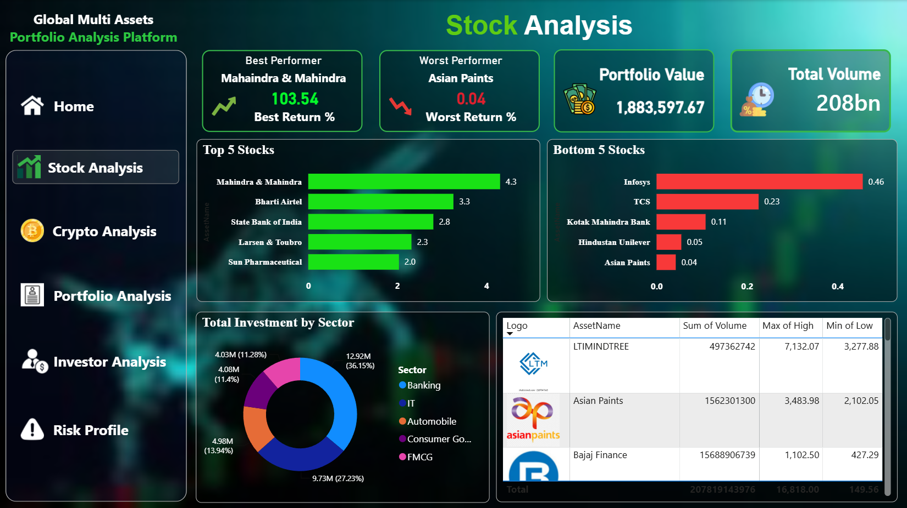
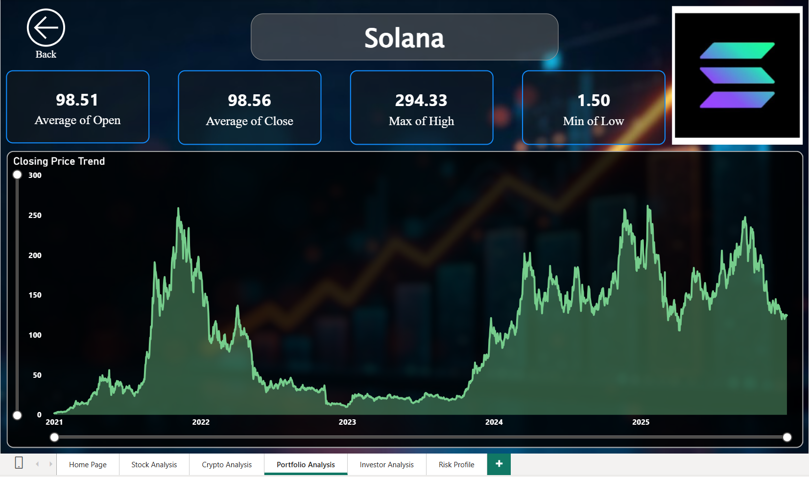
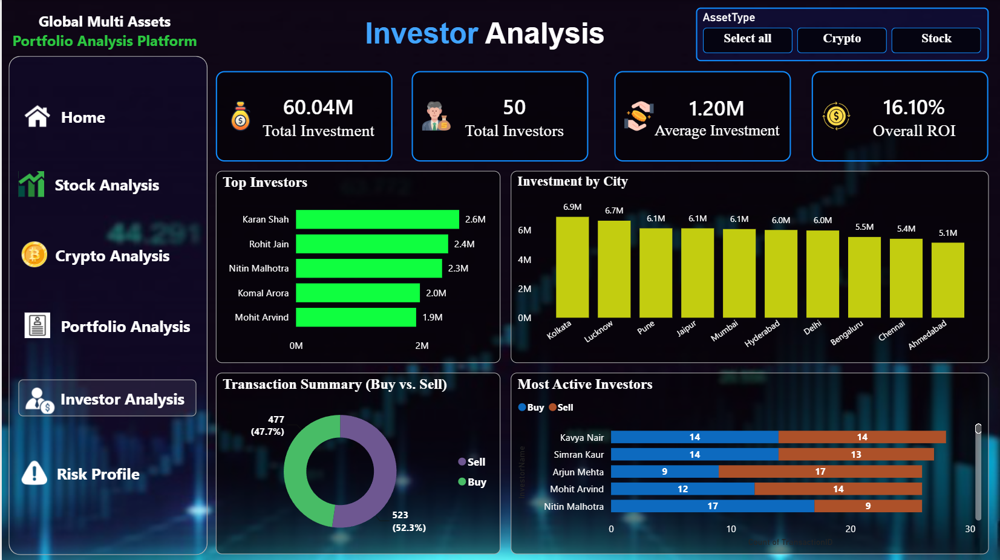
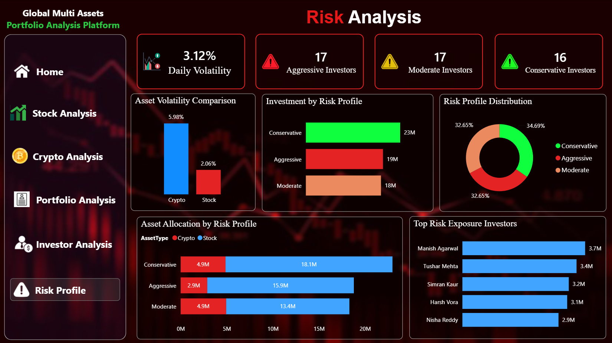

# 📈 Global Multi-Assets Portfolio Analysis Platform

## 📌 Executive Summary
An end-to-end Power BI analytics platform designed to monitor and evaluate a mixed portfolio of Stocks and Cryptocurrencies. The dashboard tracks 25 total assets across 50 investors, managing a total investment of 60.04M with an overall ROI of 16.10%.

## 🏗️ Data Architecture & Modeling
The data model follows a structured relational schema connecting transaction facts with descriptive dimensions:
* **Fact Table:** `Facts_stock` (tracking High, Low, Open, Close, Volume).
* **Dimension Tables:** `Dim_Assets`, `Dim_Date`, `Dim_Transactions`, and `Dim_Investors`.
* **Logic & Design:** Centralized `Measure` table for all DAX calculations and a dedicated `Theme` table for UI consistency.

## 📊 Dashboard Pages & Key Insights

### 1. Home Page
A navigational landing page providing high-level KPIs including Total Assets, Total Investors, Total Investment, Portfolio Value, and Overall ROI.

### 2. Stock Analysis
Deep dive into equity performance featuring the Top/Bottom 5 Stocks, Best/Worst Performers by Return %, and Total Investment breakdown by Sectors like Banking, IT, and Automobiles.

### 3. Crypto Analysis
Tracks cryptocurrency holdings (Bitcoin, Solana, Ethereum, Cardano, Binance Coin). Includes Portfolio Value Over Time, Volatility vs. ROI Analysis, and Asset Performance comparisons.

### 4. Portfolio Analysis
Detailed drill-through views for individual assets displaying historical Closing Price Trends alongside average open/close and min/max metrics.

### 5. Investor Analysis
Provides a geographical and behavioral breakdown of investors. Features include Investment by City, Top Investors by volume, and Transaction Summaries (Buy vs. Sell).

### 6. Risk Profile
Categorizes the investor base into Aggressive, Moderate, and Conservative profiles. Analyzes Daily Volatility, Risk Profile Distribution, and Asset Allocation by Risk Profile.

## 🧮 Key DAX Measures
The project utilizes extensive DAX programming for dynamic insights. Key measures include:
* `Best Performing Stock` & `Worst Performing Stock`
* `Daily Volatile %`
* `Overall ROI` & `Return %`
* `Current Holdings` & `Current Positive Holdings`
* `Aggressive / Moderate / Conservative Investors`

## 🛠️ Tech Stack
* **Business Intelligence:** Microsoft Power BI Desktop
* **Language:** DAX, Power Query (M)
* **Design:** Custom Dark Theme UI with interactive navigation buttons and bookmarks

---
**How to Run This Project:**
1. Clone this repository to your local machine.
2. Open `stocks.pbix` in Power BI Desktop.
3. The raw data files are available in the repository for reference.
